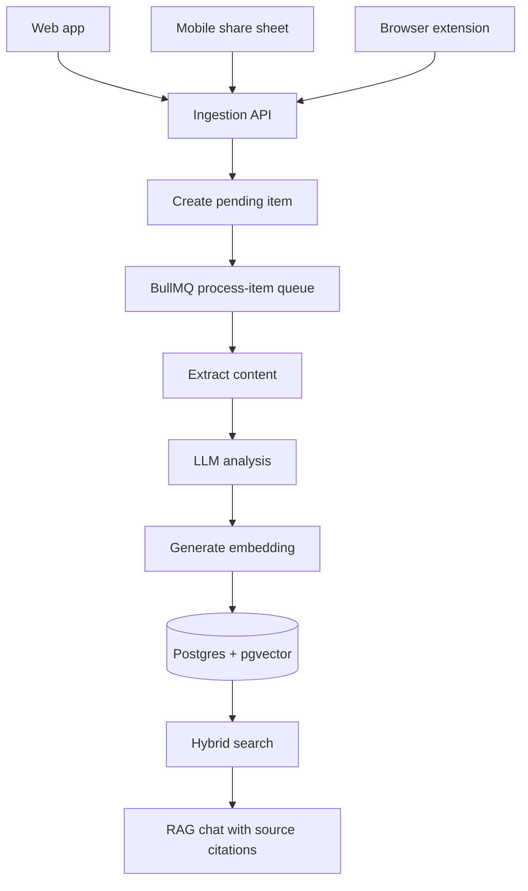

# Nucel

> Turn everything you save into knowledge you can actually use.

Nucel is an AI-powered personal knowledge management platform that transforms saved social content, articles, newsletters, and other digital resources into a searchable, connected knowledge base.

Save content from the web, mobile, or browser extension. Nucel extracts and understands it, organizes it with AI, and makes it available through hybrid search and conversational retrieval-augmented generation (RAG) — with answers grounded in your own saved material.

---

## At a glance

- **Capture from anywhere:** Save content through the web app, mobile share sheet, browser extension, and other ingestion paths.
- **Understand automatically:** Extract content and generate summaries, tags, categories, sentiment, and key topics.
- **Find what matters:** Search with keyword, semantic, and hybrid retrieval.
- **Ask your library:** Chat with your saved knowledge and receive answers linked to their source items.
- **Build a personal knowledge model:** Optional learning systems derive interests, long-term memory, topic connections, and retrieval improvements from your library.
- **Use it across devices:** Web and mobile experiences share the same backend and knowledge base.

## Product experience

<!-- Add real product screenshots in docs/assets/screenshots/ and replace these placeholders.
     Suggested captures: web home/library, Ask with cited sources, Mind, mobile Today, browser extension popup. -->

| Web app | Ask your library |
|---|---|
| <!--  --> **Screenshot coming soon** | <!--  --> **Screenshot coming soon** |

| Mobile app | Browser extension |
|---|---|
| <!--  --> **Screenshot coming soon** | <!--  --> **Screenshot coming soon** |

## How it works

A save is accepted quickly; content extraction and AI processing happen asynchronously in the background.

1. **Capture** — A user saves a URL or content from a supported client.
2. **Extract** — Nucel fetches and parses the content behind the link.
3. **Analyze** — An LLM generates a summary, tags, category, sentiment, and key topics.
4. **Embed** — The content is converted into an embedding for semantic retrieval.
5. **Retrieve** — Keyword, vector, and hybrid search make the item discoverable.
6. **Ask** — RAG uses relevant saved items as context and returns answers with source citations.



Embedding generation is best-effort: if it fails, an item can still complete and remain keyword-searchable. Failed processing is retried and ultimately recorded with an error state if retries are exhausted.

## AI and learning architecture

Nucel's core save, search, and chat experience works independently of its optional learning system. Additional learning capabilities are layered on top and can be independently disabled.

| System | Purpose |
|---|---|
| Content analysis | Produces summaries, tags, categories, sentiment, and key topics |
| Embeddings | Enables semantic retrieval over saved content |
| RAG chat | Retrieves relevant saved items and grounds responses in their content |
| Interest model | Builds recency-weighted topic affinities from a user's saves |
| Interaction signals | Captures meaningful actions that can inform personalization |
| Long-term memory | Synthesizes durable, traceable knowledge from saved items |
| Learned re-ranking | Reorders retrieval results using a trained ranking model |
| Topic clustering | Suggests connections and groupings across saved knowledge |
| Knowledge gaps | Identifies areas a well-populated topic may be missing |

The learning layers are designed with user control in mind. They can be disabled independently, and the product remains usable without them.

## Applications

Nucel is organized as a monorepo containing five applications.

| Application | Description | Main technologies |
|---|---|---|
| **Web** | Main product experience, API, and worker source | Next.js 15, React 19, TypeScript |
| **Mobile** | Companion app with five tabs and native share-sheet ingestion | Expo SDK 56, React Native, Expo Router |
| **Browser extension** | Save pages from the browser toolbar, keyboard shortcut, and supported sites | Chrome/Firefox Manifest V3, Vite, React |
| **Landing** | Marketing website and product information | Next.js 15, React 19, Tailwind CSS, GSAP, Lenis |
| **Admin** | Separate operator dashboard for system operations and product oversight | Next.js, TypeScript |

### Main product surfaces

- **Today** — a chronological and curated view of saved knowledge.
- **Library** — browse and search saved items and collections.
- **Chat / Ask** — ask questions against your personal knowledge base.
- **Mind** — explore topics, memory, connections, knowledge gaps, and timeline.
- **You** — profile insights, achievements, and personal activity.

The mobile app uses a five-tab navigation: Today, Library, Chat, Mind, and You.

## Technology stack

| Area | Technologies |
|---|---|
| Languages | TypeScript, JavaScript, SQL |
| Web | Next.js 15, React 19 |
| Mobile | Expo SDK 56, React Native, Expo Router, NativeWind |
| Browser extension | Manifest V3, Vite |
| Styling and UI | Tailwind CSS, shared UI packages, design tokens |
| AI / LLM | Gemini, Anthropic Claude, AI SDK |
| Retrieval | RAG, embeddings, hybrid search, pgvector |
| Backend processing | Node.js, BullMQ, Redis |
| Database | PostgreSQL, Supabase, Prisma 5 |
| Validation | Zod |
| Authentication | Supabase Auth |
| Monitoring / analytics | Sentry, PostHog |
| Deployment | Vercel, Fly.io, GitHub Actions |

## Architecture

The repository separates applications from shared packages. Apps consume shared functionality; shared packages do not import from applications.

```text
.
├── apps/
│   ├── web/          # Product UI, API routes, background worker source
│   ├── mobile/       # Expo / React Native companion app
│   ├── extension/    # Browser extension
│   ├── landing/      # Marketing website
│   └── admin/        # Operator dashboard
│
├── packages/
│   ├── ai/           # LLM providers, prompts, embeddings, AI features
│   ├── db/           # Prisma schema, migrations, typed database queries
│   ├── shared/       # Shared schemas, types, constants, pure logic
│   └── ui/           # Shared design tokens and UI primitives
│
└── docs/             # Architecture, app, package, development and runbook docs
```

### Background processing

The web application contains the worker's source code, but the worker runs as a separate long-lived process. BullMQ and Redis handle asynchronous processing and scheduled learning jobs.

The main item-processing pipeline is:

`PENDING → EXTRACTING → ANALYZING → EMBEDDING → DONE`

The worker retries failed jobs with backoff. Once retries are exhausted, the item is marked `FAILED` and the user can retry it.

### Data and retrieval

- **PostgreSQL** stores users, saved items, collections, chat history, interaction events, and learning-system records.
- **pgvector** stores and queries embeddings for semantic retrieval.
- **Postgres full-text search** supports keyword retrieval.
- **Hybrid retrieval** combines keyword and semantic results, with optional personalization and re-ranking.
- **Prisma** provides the typed database access layer and migration workflow.

### Privacy and user control

Nucel's architecture treats a user's saved knowledge as sensitive personal data.

- Learning features have independent controls and per-user opt-outs.
- Excluded topics can skip AI processing.
- Chat responses track the saved items used as sources.
- User deletion cascades through user-owned data.
- The admin application has a separate authentication boundary and privacy restrictions.

## Repository documentation

The `docs/` directory contains deeper engineering documentation. Start with the architecture guide, then explore the relevant application or package.

| Document | Description |
|---|---|
| [Architecture](docs/architecture.md) | End-to-end architecture, ingestion pipeline, learning system, and data flow |
| [Database](docs/database.md) | Data models, conventions, and migration strategy |
| [Shared packages](docs/packages.md) | Responsibilities and boundaries of shared packages |
| [Web app](docs/apps-web.md) | Web application, API routes, worker, and background jobs |
| [Mobile app](docs/apps-mobile.md) | Expo app structure, tabs, and ingestion |
| [Browser extension](docs/apps-extension.md) | Extension behavior, build, and local setup |
| [Landing site](docs/apps-landing.md) | Marketing site structure and design system |
| [Admin app](docs/apps-admin.md) | Operator dashboard, security boundary, and operational tooling |
| [Development guide](docs/development.md) | Prerequisites, setup, conventions, and testing |
| [Deployment](docs/deployment.md) | Deployment surfaces and release process |
| [Billing](docs/billing.md) | Plans, quotas, payment providers, and rollout runbook |
| [Documentation index](docs/README.md) | Full documentation map and suggested reading order |

## Getting started

### Prerequisites

- Node.js
- pnpm (via Corepack)
- A Supabase project with PostgreSQL, pgvector, and Auth
- Upstash Redis for BullMQ

### Local setup

```bash
corepack enable
pnpm install

# Configure environment variables
cp .env.example .env

# Build the workspace
pnpm build

# Apply database migrations
cd packages/db
pnpm db:deploy
```

Run the app or service you are working on using its package scripts. App-specific commands, environment variables, and ports are documented in the relevant `docs/apps-*.md` files.

For workspace typechecking and linting, run tasks through Turbo from the repository root. For example:

```bash
pnpm turbo typecheck lint --filter=@nucel/web
```

See the [development guide](docs/development.md) before making changes. Do not commit environment files or secrets.

## Deployment overview

| Surface | Deployment |
|---|---|
| Web app and API | Vercel |
| Background worker | Fly.io |
| Landing site | Vercel |
| Admin dashboard | Vercel |
| Android release | GitHub Releases via tag-triggered GitHub Actions |
| Browser extension | Built locally and loaded unpacked; store publication is not currently documented as complete |

Production database migrations are applied deliberately as a separate deployment step, not automatically during application deployment. See [deployment.md](docs/deployment.md) for the operational runbooks.

## Contributing

Contributions should follow the conventions in [docs/development.md](docs/development.md):

- Keep TypeScript strict and avoid `any`.
- Validate API boundaries with shared Zod schemas.
- Keep LLM prompts as named exports in the AI package.
- Run LLM work in BullMQ jobs unless the endpoint needs to stream a response.
- Keep shared packages independent of application code.
- Run typecheck and lint through Turbo from the monorepo root.

Before opening a pull request, describe the problem, the implementation, and how the change was tested.

## Project status

This README describes the architecture and capabilities documented in the repository's engineering documentation. Deployment and release availability can vary by surface; consult the deployment runbook for current operational status.

---

<p align="center">
  Built to help people turn what they save into what they know.
</p>
