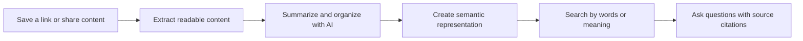
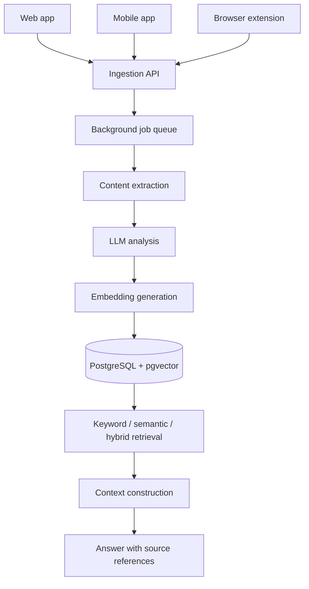

# Nucel

### Save a spark. Find the thread.

**A personal knowledge base for the things you save — made searchable, connected, and useful with AI.**

[Website](https://www.nucel.in/) · [Open the app](https://app.nucel.in/) · [Engineering case study](docs/README.md)

---

## At a glance

| | |
|---|---|
| **Product** | AI-powered personal knowledge management |
| **My role** | Technical Co-Founder |
| **Period** | June 2026 – Present |
| **Engineering focus** | AI/ML workflows · RAG · semantic retrieval · personalization · backend processing |
| **Project format** | Collaborative product engineering; this repository is a public case study, not the application source |

> I co-build Nucel and contribute across AI engineering, retrieval, personalization, and the backend systems that turn saved content into a useful personal knowledge base.

## What is Nucel?

Every day, people save useful posts, videos, articles, threads, and newsletters across different platforms. Later, finding a particular idea can be harder than saving it. Nucel brings those scattered saves into one library, reads and organizes supported content, and lets users search or ask questions in natural language — with answers linked back to the original saves.

**Product promise:** save from wherever you are, let Nucel organize what it can read, and find the thread again by meaning rather than remembering an exact title.

- **Website:** [nucel.in](https://www.nucel.in/)
- **Product:** [app.nucel.in](https://app.nucel.in/)
- **Public product walkthrough:** the website contains an interactive sample-library experience. Its sample content and scripted responses are illustrative, not a live-model benchmark.

## Product experience

  <a href="https://www.nucel.in/"><strong>Explore the product website →</strong></a>

### The core workflow

### Product surfaces

| Surface | Role in the experience | Public reference |
|---|---|---|
| Web app | Save links, browse the library, search, and ask questions | [Open Nucel](https://app.nucel.in/) |
| Android / PWA | Save content from a phone and return to the library | [Product website](https://www.nucel.in/) |
| Browser extension | Save supported web content without leaving the page | [Product website](https://www.nucel.in/) |
| Marketing site | Explains the product and presents the sample-library walkthrough | [nucel.in](https://www.nucel.in/) |

### Screenshots

The public site includes product illustrations and a sample-library demo. The one official product image directly referenced by the site is the Android save-sheet visual below. Replace or supplement it with approved screenshots from the live product when available.

  

Official website product visual · Android save sheet. Use approved current product captures for additional screens.

| Library / saved item | Ask with citations |
|---|---|
| `docs/assets/screenshots/library.png` | `docs/assets/screenshots/ask-with-citations.png` |
| Mind / topic exploration | Mobile app |
| `docs/assets/screenshots/mind.png` | `docs/assets/screenshots/mobile-library.png` |

> **Screenshot slots:** the paths above are intentional placeholders, not existing product screenshots. Add approved captures using those filenames, or update the paths in this README. See [the media guide](docs/media-and-links.md).

## My role and contributions

**Technical Co-Founder · June 2026 – Present**

My work spans product engineering and the AI/data systems behind Nucel. I work across the following areas:

- **Product engineering:** co-building a platform that turns saved social content, articles, and digital resources into a searchable, personalized knowledge base.
- **LLM workflow engineering:** designed and developed workflows for summarization, tagging, topic classification, embedding generation, and semantic retrieval, exercised across **5,000+ test items**.
- **RAG and retrieval:** contributed to vector search and contextual retrieval for personalized, source-cited answers; the project notes report a **3-second median response time**.
- **Personalization and learning:** contributed to user-interest modeling, interaction-based learning, long-term memory synthesis, topic clustering, and ML-based search re-ranking.
- **Backend and AI platform:** worked on asynchronous job processing, multi-provider LLM routing, model fallbacks, usage monitoring, and cost controls; project notes report a **35% reduction in cost per item**.

These are collaborative contributions, not a claim that every subsystem was built independently. More detail: [My role and contributions](docs/my-contributions.md).

## Engineering overview

Nucel is documented as a TypeScript monorepo with distinct product surfaces and shared packages. Content ingestion is separated from longer-running processing so a save request can return while extraction and AI work happen asynchronously.

### Documented technology stack

| Area | Technologies |
|---|---|
| Language | TypeScript, JavaScript, SQL |
| Web | Next.js, React |
| Mobile | Expo, React Native |
| Browser extension | Manifest V3, Vite, React |
| Database | PostgreSQL (Supabase), Prisma |
| Vector retrieval | pgvector, embeddings, PostgreSQL full-text search |
| Background processing | BullMQ, Redis |
| AI providers | Google Gemini and Anthropic, through shared provider routing |
| Validation / shared logic | Zod, shared TypeScript packages |
| Monitoring / analytics | Sentry, PostHog |

See [architecture](docs/architecture.md), [AI and retrieval](docs/ai-and-retrieval.md), and [technical decisions](docs/technical-decisions.md).

## Reported project metrics

The following figures come from my project/resume notes. They are **project-reported**, not independently audited or accompanied here by raw benchmark reports:

| Measure | Reported result | Context |
|---|---:|---|
| Workflow test volume | **5,000+ items** | Test items used across LLM workflows and retrieval work |
| RAG response time | **3-second median** | Reported median response time for the RAG experience |
| Processing cost | **35% lower cost per item** | Reported reduction associated with routing, fallbacks, usage monitoring, and cost controls |

See [evaluation and metrics](docs/evaluation-and-metrics.md) for what should be measured and documented to make these claims reproducible.

## Engineering case study

- [Architecture and data flow](docs/architecture.md)
- [AI workflows, embeddings, and RAG](docs/ai-and-retrieval.md)
- [Personalization and learning systems](docs/personalization.md)
- [Asynchronous processing](docs/async-processing.md)
- [My role and contributions](docs/my-contributions.md)
- [Evaluation and reported metrics](docs/evaluation-and-metrics.md)
- [Technical decisions and trade-offs](docs/technical-decisions.md)
- [Media, links, and screenshot instructions](docs/media-and-links.md)

## Scope and disclosure

This is a public engineering case study, not a mirror of Nucel's private source repository. It intentionally excludes application source code, credentials, environment variables, customer information, private dashboards, and deployment secrets. Product capabilities and architecture are summarized from project documentation and the public website. Confirm with the project owner that this overview, metrics, and any added screenshots or recordings are approved for public sharing before publishing.

---

Built around a simple idea: the things worth keeping should be easy to find again.

